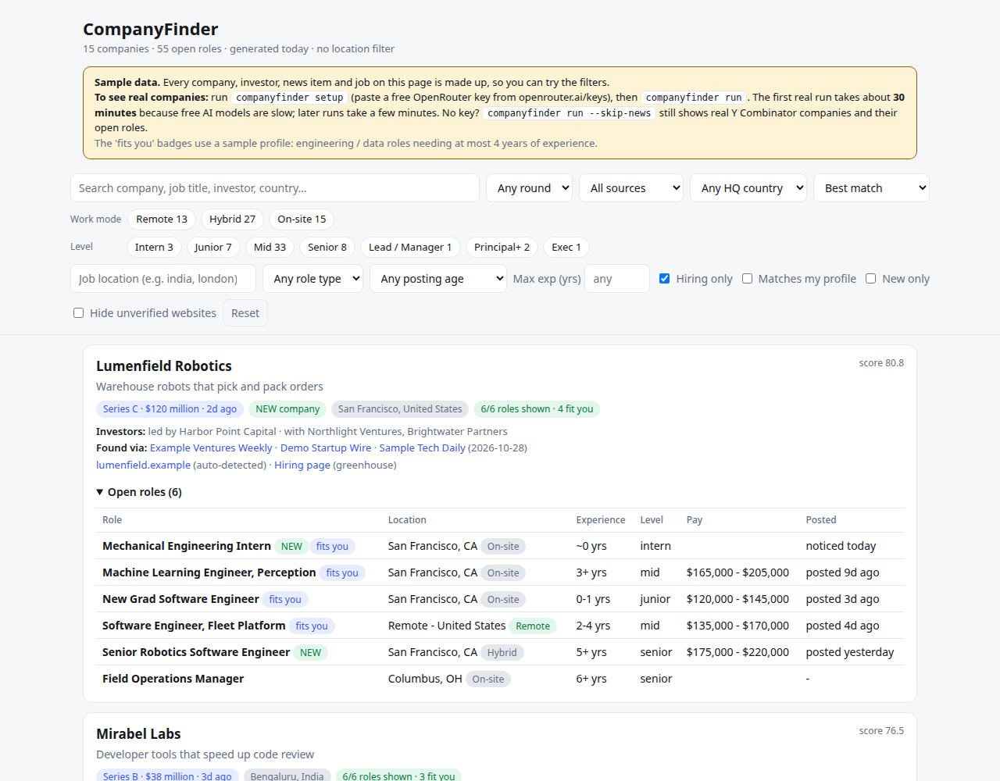
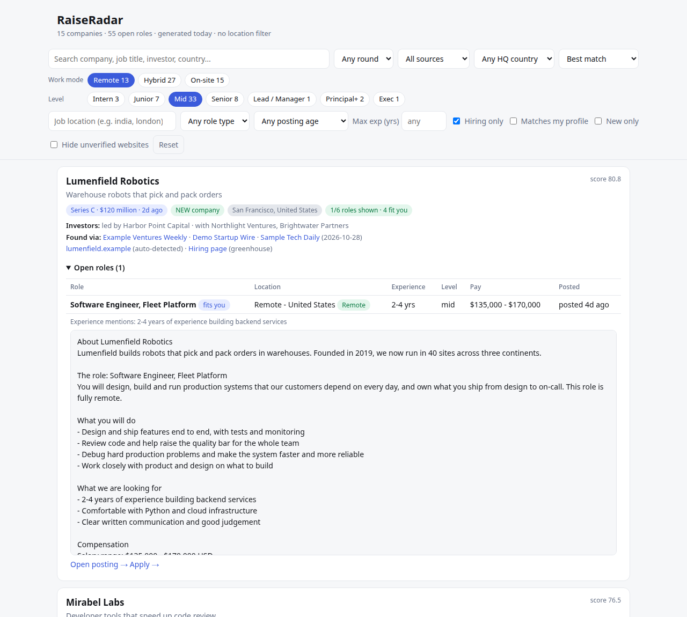

# RaiseRadar

Finds startups that **recently raised a Series B/C** (anywhere in the world), works out **whether they are hiring**, and lists every open role with **required experience, work mode, level, location, pay and the full job description**. Runs on a schedule; results land in a searchable, filterable HTML page.

```
 funding news (Google News RSS x rounds x regions + RSS feeds) ──► free LLM extracts company/round/amount/investors
 Y Combinator "hiring" list / companies you add by hand ─────────┤
                                                                 ▼
        company name ──► website (graded) ──► careers page / ATS board ──► jobs (+ full JD)
                                                                 ▼
          experience / level / work mode / pay ──► your profile ──► reports/index.html
```



## Try it first (no key, no network, 10 seconds)

```bash
python3 -m venv .venv && .venv/bin/pip install -e '.[dev]'
.venv/bin/raiseradar demo --open
```

This builds a report from **made-up companies** (clearly marked "Sample data" on the page) so you can click through every filter before deciding to run the real thing. It goes through the same code as real data, touches nothing of yours, and every link in it points at example.com.



## Get real data

The guided way: run `.venv/bin/raiseradar` with no arguments. It shows the sample report, helps you paste a free OpenRouter key (https://openrouter.ai/keys; checked with OpenRouter, stored only in `.env`, readable only by you), and offers to start the first real run.

By hand:

```bash
.venv/bin/raiseradar setup     # paste your key (or put OPENROUTER_API_KEY=... in .env yourself)
.venv/bin/raiseradar run       # first run: about 30 minutes
# add --open to `run` (or `report`) to open the page when it finishes, or:
xdg-open reports/index.html       # macOS: open
```

**The first real run takes about 30 minutes.** Free AI models take 1-3 minutes per call and the first run has a backlog of ~180 headlines; every company's website and job board is also checked once. You can press Ctrl-C at any time: what is finished is saved, a report is written from it, and the next run continues where this one stopped. Later runs only read new headlines and take a few minutes. If the free daily limit is hit, the unread headlines simply wait for the next run.

**No key, or don't want to wait?** `raiseradar run --skip-news` skips the funding news and shows real Y Combinator companies with their open roles (much faster). Companies you `add` are always processed. News headlines stay queued until you add a key.

`raiseradar bench` (optional) checks which free model works best right now.

## Commands

Times are for one run on a normal connection. "Measured" means timed on this project; the rest depend on the internet and on how busy the free AI models are.

| command | what it does | time |
|---|---|---|
| *(no command)* / `start` | guided first use: sample report, then key setup and an optional real run | seconds, plus the real run if you accept it |
| `demo [--open] [--out DIR]` | report from fictional sample companies; needs no key and touches none of your data | under 1 second (measured) |
| `setup [--check] [--replace]` | check your OpenRouter key and store it in `.env` (`--check` only tests the current one) | a few seconds |
| `run [--open] [--public]` | the whole pipeline, then rebuilds the report (`--skip-news`, `--skip-yc`, `--limit N` for quick tests; `--open` shows the page when done; `--public` see [Report for a public website](#report-for-a-public-website)) | **first run ~30 minutes**; later runs a few minutes; `--skip-news` much shorter |
| `discover` / `resolve` / `careers` / `jobs` | run one stage on its own (`--limit N`; `resolve`/`careers` take `--force`) | `discover` is the slow, LLM-bound one; the others depend on how many companies are new |
| `serve [--host H] [--port P] [--full-every HOURS] [--jobs-every HOURS] [--no-schedule] [--public]` | a web page for the report that refreshes itself on a schedule (default: full run every 12 hours, jobs every 4); this is what the Docker image runs | starts at once; the runs inside it take as long as `run` |
| `report [--open] [--public]` | rebuild the page, CSV and JSON from the database, no network | about 0.5 seconds with 155 companies / ~3,000 roles (measured) |
| `add "Acme" --website acme.com --round "Series B"` | add or correct a company by hand (also `--ats lever --slug acme` to force a job board) | instant; its jobs arrive on the next `run` |
| `resolve --recheck` | re-grade websites that were auto-matched earlier (YC / hand-added ones are never touched) | minutes (one page fetch per company) |
| `list [--top N]` | ranked companies in the terminal | under 1 second (measured) |
| `models` | OpenRouter text models that are free **right now** | a few seconds |
| `bench [model ...]` | scores models on 8 labelled headlines (a quick sanity check, not a full benchmark) | a few minutes (free models are slow) |

`--open` only works from a terminal. Under cron or in a container it is ignored, so a scheduled job never tries to start a browser.

## Fork and go (GitHub Pages, no server)

Get a page that updates itself twice a day, without installing anything or keeping a computer on:

1. **Fork** this repository.
2. In your fork: **Settings > Pages > Source: GitHub Actions**.
3. **Settings > Secrets and variables > Actions > New repository secret**: name `OPENROUTER_API_KEY`, value a free key from https://openrouter.ai/keys. (No key still works: you get real Y Combinator companies and their open roles, but no funding news.)
4. **Actions tab**: enable workflows, open **Update report**, press **Run workflow**. The first real run takes about 30 minutes; then it runs twice a day by itself (change the `cron` line in `.github/workflows/update.yml`).

Your page is at `https://<your-name>.github.io/<repo-name>/`. The run summary shows what is new. To change what you see (profile, rounds, regions), edit `config.toml` in your fork. You can also set a repository *variable* `RAISERADAR_CONTACT` (an address for the User-Agent). Manual runs offer three modes: `full`, `jobs` (only refresh open roles, no AI) and `demo` (publish the sample report).

Things to know:
- **The database is kept in the Actions cache**, so later runs only read new headlines. GitHub drops a cache that is not used for 7 days (and old ones when a repository passes 10 GB); the next run is then a cold one again.
- **The page is public** to anyone with the link, even if your repository is private (Pages for private repositories needs a paid GitHub plan). That is why it is built with `--public`: see below.
- **Scheduled workflows in a fork are off until you enable Actions**, and GitHub pauses them after 60 days without activity in the repository. Re-enable them from the Actions tab.
- Some company sites block cloud servers, so a run on GitHub may find a few fewer job boards than the same run at home.

### Report for a public website

A report on your own computer shows the full job descriptions. A public website should not republish the employers' text, so `--public` (or `[report] public = true` in `config.toml`) keeps only the first `jd_excerpt_chars` characters of each description, links to the full posting, and marks the page `noindex` so search engines skip it. The GitHub Pages workflow uses it. Everything else (roles, experience, pay, filters) is unchanged.

## Run it with Docker (always-on page)

For a computer or VM that stays on: one container shows the report on port 8080 and refreshes it by itself, no cron needed.

```bash
git clone https://github.com/mrhello291/RaiseRadar && cd RaiseRadar
echo "OPENROUTER_API_KEY=sk-or-..." > .env      # a free key from https://openrouter.ai/keys (optional, see below)
docker compose up -d
```

Open http://localhost:8080. Until the first real run finishes (about 30 minutes) the page shows the sample report. Watch progress with `docker compose logs -f`.

Without cloning, using the published image:

```bash
docker run -d --name raiseradar --restart unless-stopped -p 127.0.0.1:8080:8080 \
  -e OPENROUTER_API_KEY=sk-or-... \
  -v raiseradar-data:/app/data -v raiseradar-reports:/app/reports \
  ghcr.io/mrhello291/raiseradar:latest
```

- **Schedule:** a full run every 12 hours and a jobs-only refresh every 4 (change them in `config.toml` under `[serve]`, and mount your file by uncommenting the line in `compose.yaml`). A run that was interrupted (for example by `docker stop`) continues where it stopped.
- **Your data lives in two Docker volumes** (`docker volume ls`): the database (keep it, it holds the AI work) and the report files. Update with `docker compose pull && docker compose up -d`; the volumes stay.
- **No key:** you still get real Y Combinator companies and their open roles, but no funding news.
- **There is no login.** The compose file publishes the port to this computer only (`127.0.0.1`). To let other people see it, put it behind a reverse proxy with a password, or at least add `[report] public = true` to your `config.toml` so job descriptions are shortened (see [Report for a public website](#report-for-a-public-website)).
- The image runs as a normal user, contains no key or data (those come from `.env` and the volumes), and is built for amd64 and arm64.

## The report (`reports/index.html`)

Per company: round, amount, **investors** (and who led), **when** announced, **where it was found** (each publisher, linked), website, **hiring page link**, ATS used. Per open role: title, department, location, **work mode** (Remote / Hybrid / On-site), employment type, **required experience** (with the exact sentence it came from), level, pay when published, posting date, and the **full JD**.

Filters: search, round, source, HQ country, **work mode** chips, **level** chips (Intern ... Exec, with job counts), job **location** text (comma = any of), role type, **posting age** (7 / 30 / 90 days), max years of experience, hiring only / new only / matches my profile, and *hide unverified websites*. Your choices are remembered in the browser; *Reset* clears them.

**How old are the openings?** Only roles that are open *right now* are listed. Every run re-reads each company's job board; a role that has disappeared from it is marked closed (kept in the database, not shown or exported). The *Posted* column is the date the job board gives. If a board gives none, it shows when this tool first noticed the role, or "-" if the role was already open when the company was first checked.

**What counts as NEW:** a role posted in the last `new_days` days (by the board's own date), or, for boards with no dates, one that appeared in a later fetch than the company's first. A company is NEW when its funding was announced in the last `new_days` days. The roles you see on a first run are therefore not all flagged NEW.

Also written: `companies.csv`, `jobs.csv`, `data.json`, and `digest.md` (what is new since the last runs).

## Configuration

`config.toml` (every key is optional) and `.env`:

- `.env`: `OPENROUTER_API_KEY`, optionally `RAISERADAR_CONTACT`, and optionally `OPENROUTER_MODEL=a,b,c` (comma-separated, first preferred, rest are fallbacks) which overrides `[llm] models`.
- `[general]`: `db_path`, `report_dir`, `recent_days` (only companies funded within this window are processed), `new_days` (how long something counts as NEW), `contact` (put in the User-Agent; or set `RAISERADAR_CONTACT` in `.env` to keep your address out of git).
- `[serve]`: `host` (127.0.0.1), `port` (8080), `full_every_hours` (12), `jobs_every_hours` (4); 0 turns a schedule off.
- `[report]`: `public` (default false; same as `--public`), `jd_excerpt_chars` (700; how much of each job description a public report keeps).
- `[funding]`: `target_rounds` (add `"Series D"` etc.), `min/max_amount_usd_m`.
- `[news]`: Google News editions (regions), extra RSS feeds, `lookback_days`. `require_round_keyword=false` also catches "X raises $40M" headlines that never name the round (more LLM calls).
- `[yc]`: which YC companies to include (team size, batch year, cap).
- `[llm]`: `models` (fallback chain), `batch_size`, `max_calls_per_run`, `requests_per_minute`, `max_tokens`, `reasoning_effort`. Reasoning models spend output tokens thinking; a reply that is cut off is salvaged item by item and the unanswered headlines stay queued.
- `[http]`: timeout, per-host delay, `respect_robots` (robots.txt is honoured for company websites), worker threads.
- `[jobs]`: `max_jobs_per_company`, `rediscover_days`.
- `[profile]`: your roles (regexes), excluded titles, max years of experience, locations. Fills the "fits you" badges and the *Matches my profile* filter. Empty = no filtering.

## Scheduling

Funding news changes slowly and needs the LLM; job postings change faster and need no LLM. So run them at different rates:

```cron
# full run (news + new companies + jobs): twice a day
30 7,19 * * *  /path/to/RaiseRadar/scripts/run_daily.sh
# jobs-only refresh: every 4 hours, no LLM, no news requests
0 */4 * * *    /path/to/RaiseRadar/scripts/refresh_jobs.sh
```

Prefer not to use cron? `raiseradar serve` (or the Docker image) does this scheduling itself.

`refresh_jobs.sh` re-fetches the job lists of companies you already track and rebuilds the report. It does not look for new companies, so the full run is still needed for those. Logs go to `data/run.log`.

## What is cached, and what is re-fetched

| item | on the next run |
|---|---|
| News headlines | read once, then remembered (even the irrelevant ones). The feeds are re-downloaded (free) but nothing already seen goes to the LLM. |
| LLM replies | cached by prompt (a backup; the headline record above does most of the work) |
| Company websites | looked up once; a failed lookup is retried after 7 days |
| Careers page / job board | looked up once; no board found: retried after 14 days; temporary failure (site down/blocking): retried the next day |
| Job lists | **re-fetched every run** (one request per company, no LLM); new jobs are flagged NEW, vanished ones are marked closed. A failed fetch never closes jobs. |
| Experience / level / work mode | recomputed locally from the fetched job text |

Everything lives in `data/companyfinder.db`. Deleting it resets all of the above (including the LLM work). Old databases are upgraded automatically.

## How each piece works (and where it can be wrong)

| stage | method | known limits |
|---|---|---|
| Funding discovery | Google News RSS searches ("Series B" raises ...) per English edition + RSS feeds; regex prefilter; LLM extraction in batches. A failed batch is split in half and retried; a headline that fails 3 times is skipped. | Headlines only (no article body). The round must be stated. Non-English press is not covered. |
| Website | Guess domains from the name; accept only if the page itself proves it (name in title/h1, not parked, no redirect to an unrelated brand). Matches are graded: **verified** only if the page also agrees with what the news said the company does; otherwise **unsure** (⚠ badge, filterable). Companies resolving to the same site are merged. | Namesakes (Hive, Matrix, ASI ...) can still fool it, and 4-letter names are never auto-trusted. Fix with `add --website`, or re-grade with `resolve --recheck`. |
| Careers / ATS | Find Greenhouse / Lever / Ashby / Workable / SmartRecruiters / Recruitee links on the site; else probe guessed board slugs, accepting only boards whose postings mention the company (live and largest wins); else schema.org JSON-LD. Works even when the homepage is bot-blocked. | Custom or JavaScript-rendered careers pages have no job list we can read. Recognised but not parsed: Workday, BambooHR, Personio, Teamtailor, Rippling, Breezy, JazzHR, Jobvite, iCIMS, Oracle (the report links to their board). Typically ~45-70% of companies get a readable board. |
| Experience / level | Regex on the JD ("5+ years of experience ...", ranges, "no experience required"), company-blurb guards, "preferred" mentions lose to required ones; falls back to title seniority (shown with `~`). | Tested on ~580 real JDs (precision spot-checked; no missed "N years" phrases). Non-English JDs not handled. |
| Work mode | The ATS's own field when present (Ashby, Lever, Workable, SmartRecruiters, Recruitee); otherwise words in the location/title. | "Remote" means a remote option exists. Many postings state nothing: shown as *Not stated*. |
| Jobs | Official public ATS JSON APIs. No scraping of LinkedIn / Crunchbase / Wellfound. | Only publicly posted roles. SmartRecruiters fetches the full JD for the first 40 jobs per company. |

Free OpenRouter limits are small (roughly 20 requests/min and a low daily cap without credits), so the pipeline batches headlines, caches replies, caps calls per run (`max_calls_per_run`), and leaves unprocessed headlines queued when the limit is hit.

## Troubleshooting

- **No funding items / LLM warnings in the log**: see `data/llm_failures.jsonl` (raw text of unusable replies, with model and finish reason). Try `raiseradar models`, then `bench`, then set `OPENROUTER_MODEL`. "rate limited" is the free tier pushing back; the next model in the chain is tried automatically.
- **A company shows the wrong jobs**: its website was probably a namesake. Check the ⚠ badge, then `add "Name" --website the-right-site.com`.
- **A company shows no jobs**: the badge says why (e.g. "no careers page found", "uses workday (not supported yet)", "homepage unreachable"). Open its hiring page link; if it is a board we support but could not detect, force it: `add "Name" --ats greenhouse --slug the-slug`.
- **Start fresh**: delete `data/` (this also throws away the LLM work).

## Tests

```bash
.venv/bin/python -m pytest -q        # ~190 offline tests (under 1 second): mocked LLM + mocked internet, full pipeline included
```

## Adding an ATS

Create `raiseradar/ats/<name>.py` with `board_url(slug)`, `parse(...)` and `fetch(fetcher, slug, max_jobs) -> list[RawJob] | None`, register it in `ats/__init__.py` (`ADAPTERS` + a URL pattern in `SUPPORTED_PATTERNS`, and remove it from `UNSUPPORTED_PATTERNS` if listed there), and add a parse test.

## License and disclaimer

MIT licensed (see `LICENSE`). Free to use, change and share.

- **Not affiliated** with Y Combinator, OpenRouter, Google, or any company or job board named here or shown in a report. Names are used only to say where data comes from.
- **Data can be wrong.** Funding details are read from headlines by a free AI model, websites are matched by name, and experience and level are guessed from text. Check anything that matters at the company's own page before you act on it.
- **Public sources only.** Funding news comes from Google News RSS feeds (headline, link, publisher only), job lists from the public job-board APIs that companies publish for this purpose, and company sites are fetched lightly with `robots.txt` honoured. There is no scraping of LinkedIn, Crunchbase or Wellfound, and none is planned.
- **Job descriptions belong to the employers who wrote them.** A personal copy on your own computer is fine. If you publish a report on a public website, show an excerpt and link to the original posting instead of the full text, and check the terms of the services you use first (Google News, OpenRouter, each job board).
- The sample report uses made-up companies; any resemblance to real ones is a coincidence.
